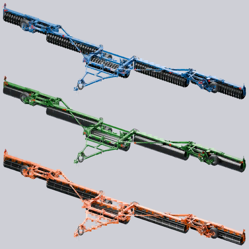

# ModHub upload: Brandt LandRoller 591A Standalone

What to enter in the GIANTS ModHub upload form for this mod. Each text box below has a copy button on GitHub.



**Mod Icon (512x512):** [`icon_512.png`](icon_512.png)

| Field | Value |
|-------|-------|
| Title English | Brandt LandRoller 591A Standalone |
| Title German | Brandt LandRoller 591A Standalone |
| Title French | Brandt LandRoller 591A Standalone |
| Version | `1` `4` `1` `2` |
| Author | DTM Mods, PropaineX |
| Manufacturer | Brandt |
| Category 1 | Yield Improvements > Rollers |
| Category 2 | Soil Cultivation > Mulchers |
| Category 3 | Grassland > Grassland Care |

## Title English
```text
Brandt LandRoller 591A Standalone
```

## Title German
```text
Brandt LandRoller 591A Standalone
```

## Title French
```text
Brandt LandRoller 591A Standalone
```

## Description English
```text
Category: Rollers
Price: $115,000
Required power: 275 hp
Working width: 27.7 m
Working speed: 14 kph

Brandt LandRoller 591A with Land roller, Grass roller and Mulcher shop configurations.
Land roller: black ring-roller drums (finned and toothed rings). Grass roller: spiral weld-bead drums. Mulcher: five black bladed drums with silver bolts, mulches while driving unfolded.
Main colour and Rim colour options for all three (default Brandt blue), no extra cost.
Original vehicle assets: GIANTS Software.
```

## Description German
```text
Shopkategorie: Walzen
Preis: 115.000 €
Benötigte Leistung: 275 PS
Arbeitsbreite: 27,7 m
Arbeitsgeschwindigkeit: 14 km/h

Brandt LandRoller 591A mit Ackerwalze, Gruenlandwalze und Mulcher als Shop-Konfiguration.
Ackerwalze: schwarze Ringwalzen (Rippen- und Zahnringe). Gruenlandwalze: Walzen mit spiralfoermiger Schweissraupe. Mulcher: fuenf schwarze Messerwalzen mit silbernen Schrauben, mulcht ausgeklappt waehrend der Fahrt.
Haupt- und Felgenfarbe fuer alle drei waehlbar (Standard Brandt-Blau), ohne Aufpreis.
Originalfahrzeug: GIANTS Software.
```

## Description French
```text
Catégorie : Rouleaux
Prix : 115 000 $
Puissance requise : 275 ch
Largeur de travail : 27,7 m
Vitesse de travail : 14 km/h

Brandt LandRoller 591A avec les configurations de boutique Rouleau de champ, Rouleau de prairie et Broyeur.
Rouleau de champ : rouleaux à anneaux noirs (anneaux à ailettes et anneaux dentés). Rouleau de prairie : rouleaux avec cordon de soudure en spirale. Broyeur : cinq rouleaux noirs à lames avec boulons argentés, broie en roulant déplié.
Couleur principale et couleur des jantes au choix pour les trois (bleu Brandt par défaut), sans supplément.
Modèle d'origine : GIANTS Software.
```

## Screenshots

Upload the 5 images in [`screenshots/`](screenshots/) (1600x900, unedited in-game shots) in this order: [`1.jpg`](screenshots/1.jpg), [`2.jpg`](screenshots/2.jpg), [`3.jpg`](screenshots/3.jpg), [`4.jpg`](screenshots/4.jpg), [`5.jpg`](screenshots/5.jpg).

## Before uploading

- The zip would contain 7 unchanged copies of GIANTS base-game files (about 29 MB): `landRoller591A.i3d.shapes` and the textures `landRoller591A_normal.dds`, `landRoller591A_vmask.dds`, `landRoller591ADecals_diffuse.dds`, `landRoller591ADecals_normal.dds`, `landRoller591AHoses_vmask.dds` and `rollerEffect01Array.dds` (checked: same SHA-256 as the game's). The six textures are not even used (the i3d and XML load them from `$data`), so they can be removed; ModHub does not accept redistributed game files, so the base `.shapes` copy needs a decision too.
- `README.txt` (old developer build notes from 1.2.0.0) goes into the zip, because `.txt` counts as a game file. Leave it out (delete it or add it to `.modignore`).
- The mod's own texts are English only: the shop name, "Tool type", "Land roller", "Grass roller", "Mulcher", "Schouten orange" and "Brandt blue" have no translations, modDesc.xml has no French description, and its German description writes ae/oe/ue instead of umlauts.
- The model is heavy: `ringDrums.i3d.shapes` alone is 43 MB (about 86 MB unpacked in total); ModHub testing looks at size and performance.
