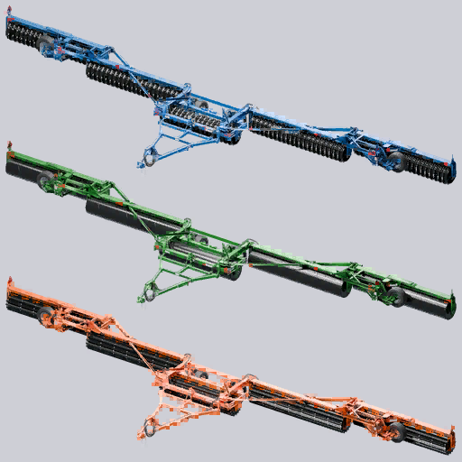

# ModHub upload: Brandt LandRoller 591A Standalone

What to enter in the GIANTS ModHub upload form for this mod. Each text box below has a copy button on GitHub.



**Mod Icon (512x512):** [`icon_512.png`](icon_512.png)

| Field | Value |
|-------|-------|
| Title English | Brandt LandRoller 591A Standalone |
| Title German | Brandt LandRoller 591A Standalone |
| Title French | Brandt LandRoller 591A Standalone |
| Version | `1` `4` `1` `2` |
| Author | DTM Mods, PropaineX |
| Manufacturer | Brandt |
| Category 1 | Yield Improvements > Rollers |
| Category 2 | Soil Cultivation > Mulchers |
| Category 3 | Grassland > Grassland Care |

## Title English
```text
Brandt LandRoller 591A Standalone
```

## Title German
```text
Brandt LandRoller 591A Standalone
```

## Title French
```text
Brandt LandRoller 591A Standalone
```

## Description English
```text
The base-game Brandt LandRoller 591A as one machine with three tool types, chosen in the shop at no extra cost: Land roller, Grass roller or Mulcher. Each type has its own drums, and the original transport wheels, folding, hitch and physics are kept. With a working width of 27.7 m it suits big fields.

- Land roller: black ring-roller drums, fat finned rings alternating with skinny toothed rings
- Grass roller: drums with a raised weld bead spiralling the full length
- Mulcher: five black bladed drums with silver bolts that mulch while you drive unfolded
- Main colour and Rim colour options with the full colour palette, default Brandt blue, no extra cost
- Working width 27.7 m, required power 275 hp, working speed 14 km/h
- Price 115,000

How to use: Shop > Rollers. Pick the tool type and colours when you buy it.

Changelog 1.4.1.1:
- First public release.
- Shop description updated to match the current machine: ring-roller and spiral drums, Brandt blue with colour options.
```

## Description German
```text
Die Brandt LandRoller 591A aus dem Grundspiel als eine Maschine mit drei Werkzeugtypen, im Shop ohne Aufpreis wählbar: Ackerwalze, Grünlandwalze oder Mulcher. Jeder Typ hat eigene Walzen; die originalen Transporträder, das Klappen, die Anhängung und die Physik bleiben erhalten. Mit 27,7 m Arbeitsbreite ist sie für große Felder gemacht.

- Ackerwalze: schwarze Ringwalzen, dicke Rippenringe im Wechsel mit schmalen Zahnringen
- Grünlandwalze: Walzen mit einer erhabenen Schweißraupe als Spirale über die ganze Länge
- Mulcher: fünf schwarze Messerwalzen mit silbernen Schrauben, mulcht ausgeklappt während der Fahrt
- Haupt- und Felgenfarbe mit der vollen Farbpalette, Standard Brandt-Blau, ohne Aufpreis
- Arbeitsbreite 27,7 m, benötigte Leistung 275 PS, Arbeitsgeschwindigkeit 14 km/h
- Preis 115.000

Bedienung: Shop > Walzen. Werkzeugtyp und Farben beim Kauf wählen.

Changelog 1.4.1.1:
- Erste öffentliche Version.
- Shop-Beschreibung an die aktuelle Maschine angepasst: Ring- und Spiralwalzen, Brandt-Blau mit Farboptionen.
```

## Description French
```text
Le Brandt LandRoller 591A du jeu de base en une seule machine à trois types d'outil, au choix dans la boutique sans supplément : rouleau de champ, rouleau de prairie ou broyeur. Chaque type a ses propres rouleaux ; les roues de transport, le repliage, l'attelage et la physique d'origine sont conservés. Avec 27,7 m de largeur de travail, il convient aux grands champs.

- Rouleau de champ : rouleaux à anneaux noirs, gros anneaux à ailettes alternant avec des anneaux dentés fins
- Rouleau de prairie : rouleaux avec un cordon de soudure en spirale sur toute la longueur
- Broyeur : cinq rouleaux noirs à lames avec boulons argentés, qui broient en roulant déplié
- Options de couleur principale et de couleur des jantes, palette complète, bleu Brandt par défaut, sans supplément
- Largeur de travail 27,7 m, puissance requise 275 ch, vitesse de travail 14 km/h
- Prix 115 000

Utilisation : Boutique > Rouleaux. Choisissez le type d'outil et les couleurs à l'achat.

Changelog 1.4.1.1 :
- Première version publique.
- Description de la boutique mise à jour : rouleaux à anneaux et en spirale, bleu Brandt avec options de couleur.
```

## Before uploading

- The zip would contain 7 unchanged copies of GIANTS base-game files (about 29 MB): `landRoller591A.i3d.shapes` and the textures `landRoller591A_normal.dds`, `landRoller591A_vmask.dds`, `landRoller591ADecals_diffuse.dds`, `landRoller591ADecals_normal.dds`, `landRoller591AHoses_vmask.dds` and `rollerEffect01Array.dds` (checked: same SHA-256 as the game's). The six textures are not even used (the i3d and XML load them from `$data`), so they can be removed; ModHub does not accept redistributed game files, so the base `.shapes` copy needs a decision too.
- `README.txt` (old developer build notes from 1.2.0.0) goes into the zip, because `.txt` counts as a game file. Leave it out (delete it or add it to `.modignore`).
- The mod's own texts are English only: the shop name, "Tool type", "Land roller", "Grass roller", "Mulcher", "Schouten orange" and "Brandt blue" have no translations, modDesc.xml has no French description, and its German description writes ae/oe/ue instead of umlauts.
- The model is heavy: `ringDrums.i3d.shapes` alone is 43 MB (about 86 MB unpacked in total); ModHub testing looks at size and performance.
